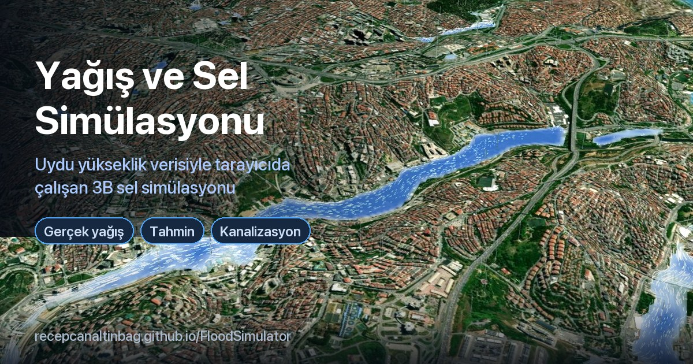

# Yağış ve Sel Simülasyonu

Tarayıcıda çalışan, gerçek yükseklik verisi üzerinde 3B yağış ve yüzey akışı simülasyonu. Bir bölge seçip yağış senaryosu verdiğinizde suyun nereye aktığını, hangi derelerin taştığını ve hangi çukurların dolduğunu dakika dakika gösterir.

**▶ Canlı:** https://recepcanaltinbag.github.io/FloodSimulator/



Kurulum gerekmez; tek bir HTML sayfası ve yardımcı betiklerden oluşur, telefonda da çalışır. Eğitim ve farkındalık amaçlıdır; mühendislik hesabı ya da resmî taşkın risk haritası yerine geçmez (bkz. [Sınırlamalar](#sınırlamalar)).

## Neler yapabilirsiniz

- **Bölge seçimi:** Haritadan herhangi bir yer ya da hazır İstanbul dereleri (Kağıthane, Ayamama, Kurbağalıdere, Alibeyköy, Haliç, Haramidere, Sarıyer, Riva); il/ilçe araması, karst alanları ve dağlar. Kamerayı kaydırınca simülasyon alanı da taşınır, su korunur.
- **Yağış senaryoları:** gerçek ölçümlere dayalı hazır senaryolar, saat saat değişen gerçek yağış, önümüzdeki 3 günün tahmini (hata payıyla) ve gizli bir "aşırı senaryolar" bölümü.
- **Kanalizasyon ve zemin:** şebeke kapasitesi, ızgara tıkanıklığı, zeminin suyu emme hızı; karst modu (düdenler) ve kapalı çukurların yeraltına boşalması.
- **Dereler:** OpenStreetMap dereleri araziye işlenir (köprü ve viyadükler akışı kesmez). "Dere" adlı yollarda akış istatistiği ve olası eski dere yatakları gösterilir.
- **Havzadan gelen su:** simülasyon alanının dışındaki yukarı havzaya düşen yağış, dere yataklarından gecikmeli olarak alana girer.
- **Drenaj alanı aracı:** bir noktaya sağ tıklayınca o noktanın drenaj alanı, toplanma süresi ve farklı yağışlarda gelebilecek debi (Rasyonel Yöntem).
- **Taşkın izi:** yağmur bitince olay boyunca su basan her yer haritada kalır.
- **Dışa aktarma:** taşkın izi, su birikebilecek çukurlar ve eski dere yatakları KML / GeoJSON / CSV olarak indirilir (Google My Maps'e aktarılabilir).
- **Yükseklik verisi seçimi:** varsayılan SRTM, FABDEM (karst alanları, dağlar ve Kağıthane için) ya da kendi GeoTIFF dosyanız (yalnızca tarayıcıda okunur, hiçbir yere gönderilmez).

## Yağış senaryoları

| Senaryo | Şiddet · süre | Dayanak |
|---|---|---|
| Kuvvetli yağış | 20 mm/sa · 1 sa | |
| Sağanak | 40 mm/sa · 2 sa | |
| Aşırı sağanak | 60 mm/sa · 2 sa | |
| 2009 Ayamama seli | 45 mm/sa · 4 sa | 9 Eylül 2009, İkitelli'de 4 saatte ~181 mm, en sert saatte ~90 mm |
| **14 Ekim 2026 · en sert 3 saat** (açılışta) | 40 mm/sa · 3 sa | Beykoz'da günde 242–277 mm (AKOM); en sert saatler 18:00–21:00 |
| 14 Ekim 2026 · 12 saat, saat saat | bölgeye göre değişir | Open-Meteo saatlik dağılımı, yakındaki AKOM ölçümlerine ölçeklenmiş |
| 🔮 Tahmin | bölgeye göre değişir | Open-Meteo; ECMWF topluluk tahmininden %10 / medyan / %90 senaryoları |
| ⚠ İklim değişikliğiyle 2009 | 60 mm/sa · 4 sa | 2009 yağışının 2–3 °C daha sıcak iklimde ~%30 daha şiddetlisi (kaba tahmin) |
| ⚠ Türkiye günlük rekoru | 40 mm/sa · 12 sa | Kemer-Ovacık, 17 Aralık 2018: 24 saatte 490,8 mm (MGM) |
| ⚠ Hopa 1988 şiddeti | 180 mm/sa · 0,5 sa | Hopa, 7 Temmuz 1988: 30 dakikada 90,9 mm (MGM) |
| ⚠ Abartılı (görsel) | 150 mm/sa · 2 sa | Gerçekte görülmez; yalnızca akış yollarını belirgin göstermek için |

⚠ işaretliler ayarlarda "Aşırı senaryolar" altında gizlidir: İstanbul'da bugüne kadar ölçülmemiş yağışlardır.

## Nasıl çalışır

- **Akış:** 2B sığ su yaklaşımı ("sanal borular" yöntemi) ve Manning sürtünmesi; 256 × 256 hücrelik pencere (orta boy bölgede hücre ≈ 29 m). LISFLOOD-FP gibi bilimsel modellerin sadeleştirilmiş bir akrabasıdır.
- **Kayıplar:** zemin sızması (sabit hız), kanalizasyon (toplu kapasite: ızgara çekişi + boru hacmi + deşarj), karst düdenleri ve kapalı çukur yutakları.
- **Dereler:** OSM dere hatları boyunca arazi alçaltılır (stream burning); köprü tablaları yalnızca görüntüde kalır.
- **Yukarı havza:** pencere dışında ~115 m'lik kaba arazi üzerinde D8 akış yönleri ve priority-flood; su, yamaçta ~0,5, derede ~1,5 m/s varsayımıyla gecikmeli girer.
- **Drenaj alanı:** Rasyonel Yöntem (Q = C·i·A/3,6) ve Kirpich toplanma süresi.

Her şey tarayıcıda, JavaScript ve Three.js ile hesaplanır; sunucu tarafı yoktur.

## Ne kadar doğru?

Model, 14 Ekim 2026 selinde haberlerde ve resmî açıklamalarda geçen 74 su baskını noktasıyla karşılaştırıldı ([rapor](docs/dogrulama-14ekim.md), [nokta listesi](docs/dogrulama-14ekim-noktalar.csv)):

- Simülasyon pencerelerine düşen 39 noktanın **%56'sında** model çevrede (150–750 m) en az 10 cm su biriktirdi; rastgele noktalarda bu oran %45.
- Model **suyun hangi vadide ve çukurda toplanacağını** kabaca bilir, **hangi sokakta** toplanacağını bilmez.
- Saatte ~25 mm'nin altındaki yağışta kanalizasyon ve zemin suyun tamamını yuttuğu için bazı ağır etkilenen bölgeler (Kemerburgaz, Riva) "kuru" kaldı. Alt geçit, tünel ve metro baskınlarını arazi verisi göremiyor.

## Sınırlamalar

- **Yükseklik verisi kaba:** 30 m çözünürlük, birkaç metre dikey hata; binalar, alt geçitler, duvarlar, bordürler ve menfezler yok. Su derinliği bu hatalardan daha küçük olduğu için en büyük belirsizlik kaynağıdır.
- **Kanalizasyon tek bir kapasiteyle** temsil edilir; gerçek boru ağı ve geri tepme yoktur.
- **Zemin emmesi sabittir;** ıslandıkça azalma ve önceki günlerin yağışı hesaba katılmaz.
- **Yağış pencere boyunca her yere eşit** düşer; gerçek sağanaklar birkaç km'lik hücrelerle gelir.
- Derinlikler belirli bir noktada iki kat fazla ya da az çıkabilir. Senaryoları **birbirleriyle karşılaştırmak** tek bir sonuca güvenmekten daha sağlıklıdır.

## Yerelde çalıştırma

```bash
python3 -m http.server 8765
```

Ardından tarayıcıda `http://localhost:8765/` adresini açın. Derleme adımı yoktur.

## Dosyalar

| Dosya | İçerik |
|---|---|
| `index.html` | Ana uygulama: arayüz, arazi yükleme, akış simülasyonu, çizim |
| `realrain.js` | Gerçek yağış ve tahmin senaryoları; diğer yardımcı betikleri yükler |
| `burn.js` | Derelerin araziye işlenmesi |
| `derestat.js` · `lostcreeks.js` · `derepanel.js` | "Dere" adlı yollar, olası eski dere yatakları, dere paneli |
| `floodtrace.js` | Taşkın izi |
| `catchment.js` · `ctxmenu.js` | Drenaj alanı aracı, sağ tık menüsü |
| `export.js` | KML / GeoJSON / CSV dışa aktarma |
| `userdem.js` | Yükseklik verisi seçimi, kendi GeoTIFF'iniz |
| `osm-cache.js` · `data/` | Gömülü OSM verisi (dereler, etiketler, hazır bölgelerin göl/yol verisi) |
| `cloudfix.js` · `edgefix.js` · `cta.js` · `clamp.js` · `ready.js` | Bulutlu uydu karosu düzeltmesi, kenar düzeltmesi, arayüz yardımcıları |
| `dem/fabdem/` | FABDEM karoları |
| `docs/` | Doğrulama raporu |

## Veri ve künye

- Yükseklik: [AWS Terrain Tiles](https://registry.opendata.aws/terrain-tiles/) (SRTM vd.)
- FABDEM v1-2: Hawker vd. (2022), *A 30 m global map of elevation with forests and buildings removed*, Environ. Res. Lett. 17 024016; University of Bristol, **CC BY-NC-SA 4.0**. `dem/fabdem/` karoları bu lisansla türetilmiştir. Copernicus WorldDEM-30 © DLR e.V. 2010-2014 ve © Airbus Defence and Space GmbH 2014-2018, Copernicus programı kapsamında AB ve ESA tarafından sağlanmıştır.
- Uydu görüntüsü: Esri World Imagery (ve Wayback arşivi); bulutlu karolarda Sentinel-2 cloudless (EOX)
- Harita verisi: © [OpenStreetMap](https://www.openstreetmap.org/copyright) katkıcıları (ODbL), Overpass API, Nominatim
- Yağış: [Open-Meteo](https://open-meteo.com/) (ECMWF topluluk tahmini dahil); ölçümler İBB AKOM ve MGM açıklamalarından
- İl/ilçe merkezleri: OSM (Nominatim) + geoBoundaries ADM2; dağ zirveleri: Wikidata/OSM
- Kütüphaneler: [Three.js](https://threejs.org/) r128, [Leaflet](https://leafletjs.com/), geotiff.js, proj4js

## Lisans

- **Kod:** [MIT](LICENSE).
- **`dem/fabdem/` karoları:** FABDEM'den türetilmiştir, **CC BY-NC-SA 4.0** (ticari olmayan kullanım, aynı lisansla paylaşım). MIT lisansının kapsamında değildir.
- **`data/istanbul_osm.json` ve `data/osm_area/`:** OpenStreetMap verisinden türetilmiştir, © OpenStreetMap katkıcıları, **ODbL 1.0**.
- **`data/tr_*.js`:** OSM/Nominatim, geoBoundaries, Wikidata ve Wikipedia'dan derlenmiş yer listeleri; kaynakların kendi koşulları geçerlidir.
- Uydu görüntüleri, yükseklik ve yağış servisleri kendi kullanım koşullarına tabidir (bkz. [Veri ve künye](#veri-ve-künye)).
